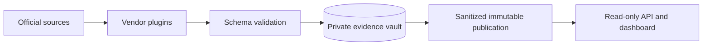

# Infrastructure Impact

**Trace a CVE from an upstream component to the infrastructure products that vendors say it affects.**

Infrastructure Impact collects official advisories and release notes for appliances,
routers, switches and security products. It preserves the source evidence, normalizes
vendor statements into a shared schema, and provides a dashboard and read-only API
for product impact, vendor comparisons, coverage gaps and disclosure research.

Early-stage software: the pipeline works end to end, but source coverage is bounded.
Missing evidence means **unknown**, never automatically **unaffected**. Comparisons
measure documented exposure in a declared CVE cohort, not overall vendor security.


*Vendor comparison view, captured 25 October 2026 from the bounded benchmark dataset.
The screenshot shows a dated research snapshot, not a live or comprehensive vendor ranking.*

## What it does

- Collects structured CSAF/CVE JSON, feeds and reviewed HTML/PDF layouts.
- Keeps product, platform, version and configuration scope attached to each claim.
- Separates affectedness from planned fixes, partial mitigation and reported fixes.
- Retains raw bytes, source URLs, hashes, capture times and normalized revisions.
- Distinguishes parser reinterpretation from changes to publisher content.
- Supports external vendor plugins without core, database or frontend changes.
- Publishes immutable, sanitized datasets for a separate read-only reader.
- Flags disclosure-timing leads for review; it does not infer intent or concealment.

Bundled vendor plugins cover **Cisco, HPE Aruba Networking, Arista, Palo Alto
Networks, Juniper, Check Point, Fortinet and other HPE products**. Each plugin has
specific source/layout limits; this is not a complete inventory of those vendors.
The benchmark spans multiple components, including PHP, OpenSSL, OpenSSH, curl,
Log4j and Linux. Custom CVE cohorts are supported.

**[Open the public dashboard](https://abedegno.github.io/infrastructure-impact/)** · [Coverage catalogue](docs/COVERAGE.md) · [Benchmark methodology](docs/BENCHMARK.md)

The hosted static reader refreshes through a scheduled collector with encrypted evidence backups; see
[hosting and recovery](docs/HOSTED_SERVICE.md) for cadence, monitoring and limits.

## Quick start with Docker

Requirements: Docker Engine/Desktop and Docker Compose v2.

```sh
docker compose up --build -d
docker compose logs -f collector
```

Open **http://127.0.0.1:8080** after the first collection, which can take several
minutes and requires outbound HTTPS. The reader returns 503 until a dataset is
published. Collection starts immediately, then runs daily at 08:15 Europe/London.
Source failures remain visible in Collection health.

The private evidence vault and public publications use separate named volumes.
The reader mounts only public data, read-only. The default port binds to loopback.
Stop services with `docker compose down`; volumes remain. Avoid running another
scheduled writer against the same vault. See [operations](docs/OPERATIONS.md) for
HTTPS, custom configuration, backups, recovery and single-host deployment limits.

## Run from source

Requirements: Python 3.11+, [uv](https://docs.astral.sh/uv/), and Poppler's
`pdftotext` for PDF sources. Node.js/npm are needed for frontend development checks.

From a checkout:

```sh
uv sync --frozen --group build --group hosted
uv run impact plugins
uv run impact migrate
uv run impact collect
uv run impact serve
```

Open **http://127.0.0.1:8765**. `impact collect` performs one pass; use the container
worker for an independent scheduled service. `impact --help` lists the supported
commands. No credentials or vendor accounts are bundled.

## Architecture and extension points



The supported topology is one writer with SQLite/WAL and one or more readers on
shared POSIX storage. Data publication does not require reader restart or code
redeployment. This is not a distributed or high-availability database.

The normalized [JSON Schema v2](infrastructure_impact/schemas/advisory-v2.json)
covers advisory identity, CVE scope, product identity, platforms, version
expressions, assessments, remediations and provenance. Dates retain publisher
precision; capture and normalization times are separate. Appliance versions are
not compared with generic semantic-version rules.

Vendor extensions register through the `infrastructure_impact.vendors` Python
entry-point group. See the [plugin guide](docs/PLUGINS.md) and
[standalone example](examples/vendor-plugin). The installed-wheel check exercises
a separately packaged ninth vendor outside the source checkout.

## API

```sh
curl 'http://127.0.0.1:8765/api/v1/advisories?limit=10'
curl 'http://127.0.0.1:8765/api/v1/assessments?cve=CVE-2024-6387&vendor=cisco'
curl 'http://127.0.0.1:8765/health/ready'
```

Responses identify their publication generation. The service also supplies JSON/CSV
exports, evidence fingerprints, the schema and an OpenAPI specification. There are
no public write, raw-evidence or collection-trigger endpoints.
[API reference](docs/API.md) · [OpenAPI 3.1](infrastructure_impact/resources/openapi.json)

## Development

```sh
uv sync --frozen --group build --group hosted
npm ci --ignore-scripts
uv run pytest -q
uv run ruff check infrastructure_impact checks tests/test_architecture.py tests/test_expansion.py tests/test_release_sources.py ops
uv run ruff format --check infrastructure_impact checks tests/test_architecture.py tests/test_expansion.py tests/test_release_sources.py ops
npm run format:check
uv run --group build python -m build --wheel --no-isolation
uv run python checks/distribution.py
```

Tests use small [synthetic fixtures](tests/fixtures/README.md), run offline and do
not require the maintainer's database. Poppler-dependent tests skip when the tool
is unavailable. Network collection and real HTTP/container checks are separate
integrations. `verify_pilot.py` is an optional check against a populated local
research vault, not a clean-checkout requirement.

The installed-wheel integration check may download its locked dependencies and
the example plugin's build requirements. Use `checks/distribution.py --offline`
only after those dependencies have been cached.

## Documentation

| Guide | Contents |
| --- | --- |
| [Architecture](docs/ARCHITECTURE.md) | Modules, evidence flow, publication and trust boundaries |
| [Plugins](docs/PLUGINS.md) | Add a vendor and package an extension |
| [Schema](docs/SCHEMA.md) | Normalization semantics and invariants |
| [Operations](docs/OPERATIONS.md) | Configuration, deployment, monitoring and recovery |
| [Methodology](docs/METHODOLOGY.md) | Comparison bias, evidence standards and disclosure research |
| [Contributing](CONTRIBUTING.md) | Changes, regression tests and review expectations |
| [Security](SECURITY.md) | Reporting vulnerabilities in this project |
| [Releasing](docs/RELEASING.md) | Prepare a clean public source tree and release |
| [Hosted service](docs/HOSTED_SERVICE.md) | Public deployment, monitoring and private backups |
| [Disclosure research](docs/DISCLOSURE_RESEARCH.md) | Release revision and availability evidence gates |
| [Roadmap](docs/ROADMAP.md) | Current boundaries and planned capabilities |

## License and data

Original project code, documentation and synthetic fixtures are licensed under
[Apache-2.0](LICENSE). See [NOTICE](NOTICE) and [third-party/data policy](THIRD_PARTY.md).
Vendor documents, names and trademarks remain subject to their respective rights
and terms. Collecting or normalizing material does not relicense it. Full captured
vendor documents, private reviews, local databases and generated research outputs
are excluded from the public source distribution.

This is an independent project; the named vendors do not endorse it. Consult the
linked primary advisory before taking operational action.

Browser-visible public release histories can be retained through the private
[browser-assisted evidence workflow](docs/BROWSER_CAPTURE.md), with capture
provenance and completeness checks kept separate from scheduled HTTP collection.
