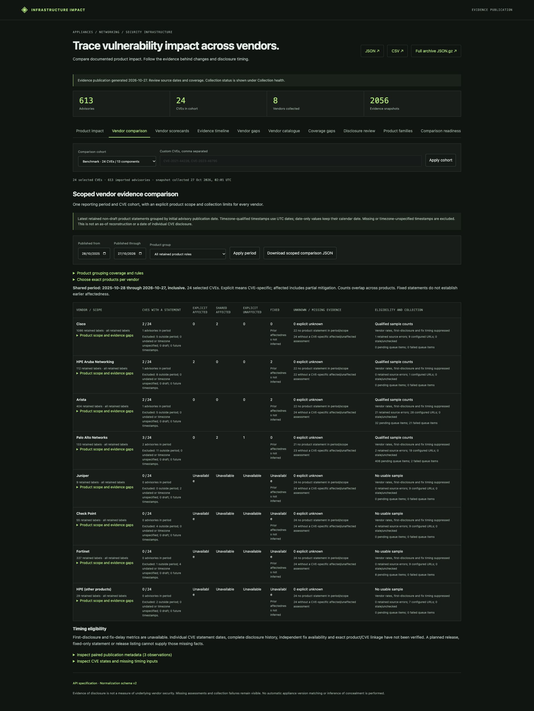
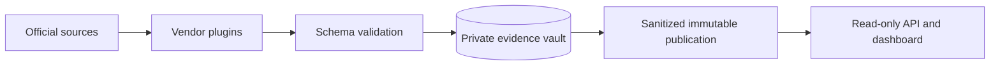

# Infrastructure Impact

**Trace a CVE from an upstream component to the infrastructure products that vendors say it affects.**

Infrastructure Impact collects official advisories and release notes for appliances,
routers, switches and security products. It preserves the source evidence, normalizes
vendor statements into a shared schema, and provides a dashboard and read-only API
for product impact, vendor comparisons, coverage gaps and disclosure research.

Early-stage software: the pipeline works end to end, but source coverage is bounded.
Missing evidence means **unknown**, never automatically **unaffected**. Comparisons
measure documented exposure in a declared CVE cohort, not overall vendor security.



_Vendor comparison view, captured 27 October 2026 from the bounded 24-CVE benchmark dataset.
The selected publication window is 28 October 2025 through 27 October 2026;
source coverage and timing limits are visible, and vendor rates remain suppressed.
The screenshot shows a dated research snapshot, not a live or comprehensive vendor ranking._

## What it does

- Collects structured CSAF/CVE JSON, feeds and reviewed HTML/PDF layouts.
- Adds [family evidence, comparison readiness and dated fix leads](docs/RESEARCH_FOUNDATIONS.md) with explicit coverage gaps and alternative explanations.
- Supports bounded historical collection, offline parser recovery and
  [archive layout triage](docs/ARCHIVE_TRIAGE.md) before ingestion.
- Shows a [vendor coverage matrix](docs/COVERAGE_MATRIX.md) with source routes, archive progress, retained formats and collection gaps.
- Keeps product, platform, version and configuration scope attached to each claim.
- Separates affectedness from planned fixes, partial mitigation and reported fixes.
- Retains raw bytes, source URLs, hashes, capture times and normalized revisions.
- Distinguishes parser reinterpretation from changes to publisher content.
- Preserves [reviewed HTML and structured source choices](docs/SOURCE_SELECTION.md)
  when publisher representations have different product scope.
- Logs [retrieval checks separately from source revisions](docs/SOURCE_OBSERVATIONS.md), including unchanged checks and HTTP 304 cache validation.
- Supports external vendor plugins without core, database or frontend changes.
- Publishes immutable, sanitized datasets for a separate read-only reader.
- Groups comparable product roles while exposing unmapped labels and coverage gaps.
- Publishes source-led extraction checks and blind independent-review packets.
- Investigates disclosure leads with publisher histories and counter-evidence.
- Prepares and audits private exact-build inventory evidence with a [vendor-neutral contract](docs/BUILD_INVENTORY.md), without certifying CVE exposure.
- Watches reviewed OSS component references with explicit patch/deployment limits;
  exposes comparison protocols and source provenance for each common-CVE cell.

Bundled vendor plugins cover **Cisco, HPE Aruba Networking, Arista, Palo Alto
Networks, Juniper, Check Point, Fortinet and other HPE products**. Juniper also verifies vendor-authored CNA records; HPE coverage includes curated iLO and ProLiant bulletins. These remain bounded sources, not whole-portfolio coverage. Each plugin has
specific source/layout limits; this is not a complete inventory of those vendors.
The benchmark spans multiple components, including PHP, OpenSSL, OpenSSH, curl,
Log4j and Linux. Custom CVE cohorts are supported.

[Product grouping](docs/PRODUCT_GROUPS.md) · [Extraction validation](docs/EXTRACTION_VALIDATION.md) · [Disclosure pilot](docs/research/disclosure-pilot-20261026.md)

**[Open the public dashboard](https://abedegno.github.io/infrastructure-impact/)** · [Source releases](https://github.com/abedegno/infrastructure-impact/releases) · [Coverage catalogue](docs/COVERAGE.md) · [Benchmark methodology](docs/BENCHMARK.md)

The [OpenSSH service study](docs/COMPONENT_STUDIES.md) uses a frozen CVE cohort
across six selected firewall families. Unknown cells remain unknown; rates and
rankings are suppressed pending defensible coverage and independent review.

Historical collection resumes in bounded batches for Aruba, Arista, Palo Alto
and Fortinet. [Archive source reviews](docs/research/vendor-archives.md) document
product filters, access gaps and why Cisco archive backfill remains disabled.

The hosted static reader refreshes through a scheduled collector with encrypted evidence backups; see
[hosting and recovery](docs/HOSTED_SERVICE.md) for cadence, monitoring and limits.

## Quick start with Docker

Requirements: Docker Engine/Desktop and Docker Compose v2.

```sh
docker compose up --build -d
docker compose logs -f collector
```

Open **http://127.0.0.1:8080** after the first collection, which can take several
minutes and requires outbound HTTPS. The reader returns 503 until a dataset is
published. Collection starts immediately, then runs daily at 08:15 Europe/London.
Source failures remain visible in Collection health.

The private evidence vault and public publications use separate named volumes.
The reader mounts only public data, read-only. The default port binds to loopback.
Stop services with `docker compose down`; volumes remain. Avoid running another
scheduled writer against the same vault. See [operations](docs/OPERATIONS.md) for
HTTPS, custom configuration, backups, recovery and single-host deployment limits.

## Run from source

Requirements: Python 3.11+, [uv](https://docs.astral.sh/uv/), and Poppler's
`pdftotext` for PDF sources. Node.js/npm are needed for frontend development checks.

From a checkout:

```sh
uv sync --frozen --group build --group hosted
uv run impact plugins
uv run impact migrate
uv run impact collect
uv run impact serve
```

Open **http://127.0.0.1:8765**. `impact collect` performs one pass; use the container
worker for an independent scheduled service. `impact --help` lists the supported
commands. No credentials or vendor accounts are bundled.

## Architecture and extension points



The static browser loads selected CVE evidence in verified parts. Explicit JSON
and compressed JSON downloads contain the whole publication, independent of the
selected cohort. See [static delivery](docs/STATIC_DELIVERY.md) for integrity checks
and transfer budgets.

The supported topology is one writer with SQLite/WAL and one or more readers on
shared POSIX storage. Data publication does not require reader restart or code
redeployment. This is not a distributed or high-availability database.

The normalized [JSON Schema v2](infrastructure_impact/schemas/advisory-v2.json)
covers advisory identity, CVE scope, product identity, platforms, version
expressions, assessments, remediations and provenance. Dates retain publisher
precision; capture and normalization times are separate. Appliance versions are
not compared with generic semantic-version rules.
Component references use a separate
[versioned schema](infrastructure_impact/schemas/component-inventory-v1.json),
validated before baseline storage or research analysis; component presence and
version references do not establish appliance affectedness.

Vendor extensions register through the `infrastructure_impact.vendors` Python
entry-point group. See the [plugin guide](docs/PLUGINS.md) and
[standalone example](examples/vendor-plugin). The installed-wheel check exercises
a separately packaged ninth vendor outside the source checkout.

## API

```sh
curl 'http://127.0.0.1:8765/api/v1/advisories?limit=10'
curl 'http://127.0.0.1:8765/api/v1/assessments?cve=CVE-2024-6387&vendor=cisco'
curl 'http://127.0.0.1:8765/health/ready'
```

Responses identify their publication generation. The service also supplies JSON/CSV
exports, evidence fingerprints, the schema and an OpenAPI specification. There are
no public write, raw-evidence or collection-trigger endpoints.
[API reference](docs/API.md) · [OpenAPI 3.1](infrastructure_impact/resources/openapi.json)

## Development

```sh
uv sync --frozen --group build --group hosted
npm ci --ignore-scripts
uv run pytest -q
uv run ruff check infrastructure_impact checks tests/test_architecture.py tests/test_expansion.py tests/test_release_sources.py ops
uv run ruff format --check infrastructure_impact checks tests/test_architecture.py tests/test_expansion.py tests/test_release_sources.py ops
npm run format:check
uv run --group build python -m build --wheel --no-isolation
uv run python checks/distribution.py
```

Tests use small [synthetic fixtures](tests/fixtures/README.md), run offline and do
not require the maintainer's database. Poppler-dependent tests skip when the tool
is unavailable. Network collection and real HTTP/container checks are separate
integrations. `verify_pilot.py` is an optional check against a populated local
research vault, not a clean-checkout requirement.

The installed-wheel integration check may download its locked dependencies and
the example plugin's build requirements. Use `checks/distribution.py --offline`
only after those dependencies have been cached.

## Documentation

| Guide                                                    | Contents                                                          |
| -------------------------------------------------------- | ----------------------------------------------------------------- |
| [Architecture](docs/ARCHITECTURE.md)                     | Modules, evidence flow, publication and trust boundaries          |
| [Plugins](docs/PLUGINS.md)                               | Add a vendor and package an extension                             |
| [Schema](docs/SCHEMA.md)                                 | Normalization semantics and invariants                            |
| [Operations](docs/OPERATIONS.md)                         | Configuration, deployment, monitoring and recovery                |
| [Methodology](docs/METHODOLOGY.md)                       | Comparison bias, evidence standards and disclosure research       |
| [Contributing](CONTRIBUTING.md)                          | Changes, regression tests and review expectations                 |
| [Security](SECURITY.md)                                  | Reporting vulnerabilities in this project                         |
| [SBOM observations](docs/SBOM_OBSERVATIONS.md) | Private SPDX/CycloneDX field normalization and provenance |
| [Build inventory](docs/BUILD_INVENTORY.md) | Private evidence proposals, byte checks and review boundaries |
| [Product cohorts](docs/PRODUCT_COHORTS.md) | Product/build scope and denominator gaps |
| [Source access](docs/SOURCE_ACCESS.md) | Runner checks for reviewed source alternatives |
| [Disclosure research](docs/DISCLOSURE_RESEARCH.md) | Evidence gates and investigation queue |
| [Releasing](docs/RELEASING.md)                           | Prepare a clean public source tree and release                    |
| [Capacity](docs/CAPACITY.md) | Storage profiling and explicit bounded recovery profiles |
| [Scheduled reliability](docs/SCHEDULE_RELIABILITY.md) | Actual scheduled-run observations and missing-trigger checks |
| [Hosted service](docs/HOSTED_SERVICE.md)                 | Public deployment, monitoring and private backups                 |
| [Source audit](docs/SOURCE_AUDIT.md)                     | Source scopes, fingerprints and unresolved collection limits      |
| [Source choices](docs/SOURCE_SELECTION.md)               | Reviewed differences between HTML and structured representations  |
| [Archive collection](docs/ARCHIVE_COLLECTION.md)         | Bounded queues, retry policy and retained-capture parser recovery |
| [Retrieval history](docs/SOURCE_OBSERVATIONS.md)         | Unchanged checks, cache validation and content revisions          |
| [Browser evidence](docs/BROWSER_CAPTURE.md)              | Private browser-assisted capture and completeness checks          |
| [Static delivery](docs/STATIC_DELIVERY.md)               | Verified cohort parts and full public archive downloads           |
| [Vendor gaps](docs/VENDOR_GAPS.md)                       | Collection, archive and source-review gaps                        |
| [Scorecards](docs/SCORECARDS.md)                         | Evidence counts and dated revision timelines                      |
| [Comparison eligibility](docs/COMPARISON_ELIGIBILITY.md) | Shared periods, exact product scopes and suppression rules        |
| [Component studies](docs/COMPONENT_STUDIES.md)           | Frozen enrollment, reference drift and per-cell evidence          |
| [Research foundations](docs/RESEARCH_FOUNDATIONS.md)     | Product families, readiness and alternative fix explanations      |
| [Case files](docs/CASE_FILES.md)                         | Source-linked disclosure questions and counter-evidence           |
| [Roadmap](docs/ROADMAP.md)                               | Current boundaries and planned capabilities                       |

## License and data

Original project code, documentation and synthetic fixtures are licensed under
[Apache-2.0](LICENSE). See [NOTICE](NOTICE) and [third-party/data policy](THIRD_PARTY.md).
Vendor documents, names and trademarks remain subject to their respective rights
and terms. Collecting or normalizing material does not relicense it. Full captured
vendor documents, private reviews, local databases and generated research outputs
are excluded from the public source distribution.

This is an independent project; the named vendors do not endorse it. Consult the
linked primary advisory before taking operational action.
