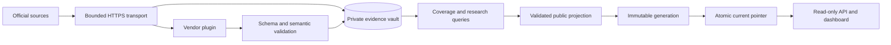

# Architecture

## Package boundaries

| Module | Responsibility |
| --- | --- |
| `collection/transport.py` | HTTPS/domain/redirect policy, conditional retrieval, size limits, retries and timeouts. |
| `collection/service.py` | Vendor-independent orchestration and collection health. |
| `plugins/` | Registration, publisher routing, special feed handling and source precedence. |
| `adapters/` | Reviewed source transformations and shared CSAF/CVE JSON readers. |
| `domain.py`, `schemas/` | The normalized contract and cross-field invariants. |
| `storage/` | SQLite transactions, checksummed migrations, revisions, fingerprints and audit. |
| `application/` | Coverage, comparison, research, benchmark backfill and publication. |
| `http.py` | Public-generation reader; no evidence-database access. |
| `web/` | Buildless frontend with shared data-selection/export behavior. |

Root service scripts and the `web` link preserve workspace compatibility without
duplicating the packaged implementations. The original `impact.py` importer and
its tests remain as a historical prototype; the installed service never imports it.
Installed wheels include runtime resources,
schemas, migrations and frontend assets; no checkout imports are required.

## Evidence and revisions

The writer holds a process lock for each collection pass. Transport retains source
bytes, URL, SHA-256 and first capture time before parsing. Plugins produce records
through a pure interface; schema validation runs at normalization and persistence
boundaries. Unknown layouts remain evidence and failed checks, not product claims.

Consecutive identical states are idempotent; A → B → A creates a new revision.
Parser reinterpretation, publisher changes and source-view switches are distinct.
A CVE appearing in another representation does not become a late-disclosure alert.
Plugins can retain a detailed article over an abbreviated index. Applied SQL is
immutable and checksummed; migration failures roll back DDL and version markers.

## Publication boundary

The public projection removes raw sources, private fix candidates, unconfigured
research documents, review bases and extension payloads. Every advisory is
validated before a generation is written. Generations contain the dataset, CSV,
fingerprints, summarized changes, assets, schema, API specification and checksum
manifest. A completed generation atomically replaces `current` by symlink rename.
Validation/write failures leave the previous generation available.

An all-failed collection does not publish a fresh timestamp over old evidence.
A separate minimal run receipt supports health reporting without private exception
details. Readers capture one generation per request and notice updates without
restart. The reader container has no vault mount and its publication mount is
read-only. There are no public write or collection-trigger routes.

## Deployment and scale

The supported topology is one writer and one or more readers on one host with
shared POSIX storage. The Compose production overlay adds HTTPS. Code deployment
and data publication are separate operations. GitHub Pages serves the public
static reader; a scheduled GitHub Actions job runs the collector using its own
retained public-source evidence. Earlier private Sites previews are separate.
Neither static host runs the Python writer.

SQLite/WAL and complete generations suit the current research/community scale.
This is not a multi-writer, multi-region or unlimited-corpus system. Larger scale
requires indexed search, partitioned exports, a distributed writer lease and an
object-store publication backend. Version matching, publisher signature checking
and full CSAF conformance validation are separate future capabilities.

Plugins are trusted operator-installed Python code. Remote feed data cannot name
a module to import. Schema validity establishes structure and scope consistency,
not truth, exploitability or comprehensive vendor coverage.

Revision comparison groups every assessment branch by CVE and product identity,
then compares order-independent branch lists. Removal counts and status lists
survive the public projection without exporting private conditions or notes. A
removed branch is a review signal, never an unaffectedness claim. Changes retain
their source revision, parser reinterpretation or source-view classification;
changed extraction alone does not establish a publisher disclosure change.

## Cohort delivery

The public projection feeds a content-addressed static delivery layer. See
[Static cohort delivery](STATIC_DELIVERY.md) for the index contract, budgets, cache
behavior, integrity checks and parity tests. The Python reader and full snapshot
retain their existing contracts; selected browser transfers preserve global
product-label scope without loading unrelated assessment bodies.

## Private build evidence proposals

The inventory proposal contract is an offline input boundary. Vendor policy
comes from installed plugins; target components and service roles are caller
supplied. Audit reads only named bounded local files and checks exact byte
identity. It opens no evidence database and makes no network or publication
request. Neither declared field completeness nor matching bytes certifies
authenticity, semantic scope, redistribution rights or comparison eligibility.
The public projection generates blank templates from the bundled pilot targets,
without accepting operator proposals. See [Build inventory](BUILD_INVENTORY.md).
